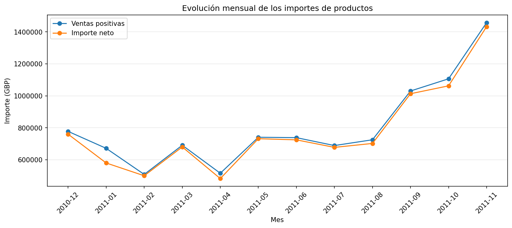
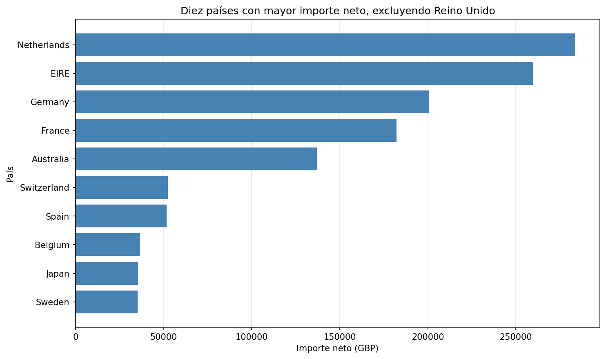
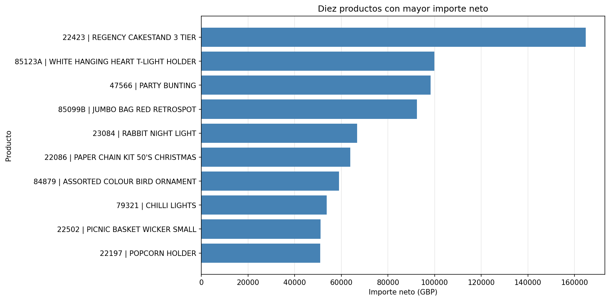

# Limpieza y análisis exploratorio de ventas con Python

Proyecto de portafolio de Matías Almonacid Mellado sobre el conjunto **Online Retail** de UCI. El notebook documenta la revisión de calidad, las decisiones de filtrado y el análisis de importes por mes, país y producto.

## Preguntas

- ¿Qué registros sirven para analizar movimientos de productos?
- ¿Cuánto cambian los resultados al eliminar repeticiones exactas?
- ¿Cómo se distribuye el importe neto por mes, país y producto?

## Datos y atribución

Chen, D. (2015). *Online Retail*. UCI Machine Learning Repository. https://doi.org/10.24432/C5BW33

541.909 líneas de factura y ocho columnas; del 1 de diciembre de 2010 al 9 de diciembre de 2011. Los datos tienen licencia **CC BY 4.0**: https://creativecommons.org/licenses/by/4.0/

Descarga oficial: https://archive.ics.uci.edu/static/public/352/online%2Bretail.zip

Descomprime y coloca `Online Retail.xlsx` junto al notebook. El dataset se descarga por separado y no se incluye en este repositorio.

## Ejecución

Se recomienda un entorno virtual con Python 3.11 o 3.12. Desde la carpeta del proyecto:

```bash
python -m pip install -r requirements.txt
python -m jupyterlab
```

Abre `online_retail_analysis.ipynb` y ejecuta todas las celdas en orden. No requiere GPU. La lectura del Excel puede tardar. El análisis genera CSV en `resultados/` y gráficos en `figures/`.

## Decisiones de análisis

Se conservan movimientos con precio positivo y cantidad distinta de cero. Se excluyen los conceptos identificados de envíos, comisiones, descuentos, deuda, operaciones manuales, muestras y vales. Se mantienen las cancelaciones, los registros sin cliente y las repeticiones exactas. Estas últimas se evalúan también en un escenario alternativo.

El importe se calcula como cantidad por precio. El importe neto de productos suma movimientos positivos y negativos dentro del alcance seleccionado; no representa ganancias ni toda la contabilidad del negocio.

## Resultados

| Indicador | Resultado |
| --- | ---: |
| Movimientos seleccionados | 536.465 |
| Registros excluidos | 5.444 |
| Importe neto registrado | £9.792.708,88 |
| Reducción del importe neto al quitar repeticiones | 0,22 % |
| Participación de Reino Unido | 84,77 % |
| Participación de los diez productos principales | 8,18 % |

Noviembre de 2011 es el mes completo con mayor importe neto. Diciembre de 2011 solo incluye registros hasta el día 9 y se excluye de la comparación gráfica mensual.







## Archivos

- `online_retail_analysis.ipynb`: código, explicaciones y resultados.
- `requirements.txt`: dependencias.
- `figures/`: tres gráficos.
- `resultados/`: tablas agregadas y comparación de repeticiones.
- `.gitignore`: excluye el Excel original, archivos temporales y los CSV detallados que se regeneran al ejecutar.

## Limitaciones

No se pueden confirmar patrones estacionales con un único ciclo anual. Las cancelaciones se contabilizan en su fecha de registro y no se emparejan sistemáticamente con todas las ventas. No hay costos para estudiar rentabilidad ni un identificador único de línea para confirmar errores de duplicación. Los clientes faltantes limitan cualquier análisis individual. Se usan números decimales de coma flotante con redondeo para presentar importes: este es un análisis exploratorio, no un sistema contable.

## Verificación

Código ejecutado secuencialmente desde un proceso Python limpio con Python 3.12, pandas 2.2.3, Matplotlib 3.10.8 y openpyxl 3.1.5. Se verificaron los conteos, el importe neto y la participación de los diez productos principales. El archivo notebook pasó la validación de formato.
